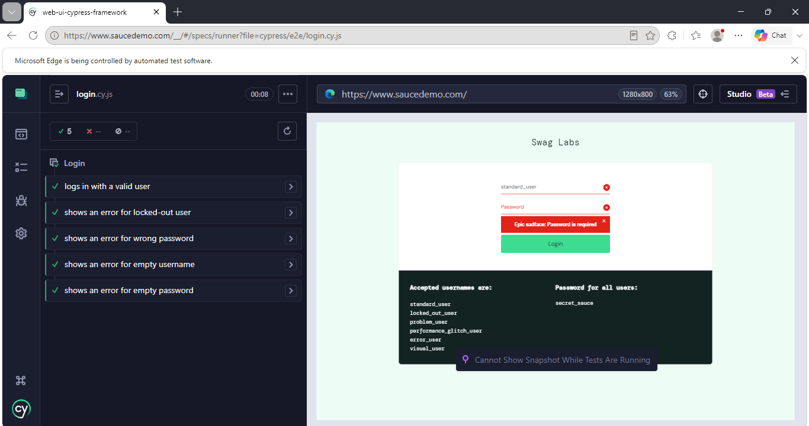
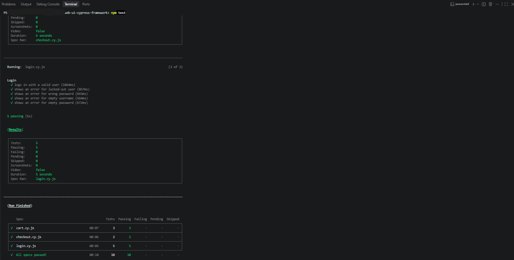

# Web UI Test Automation Showcase (Cypress + JavaScript)


> A production-style web UI automation framework I built with Cypress to demonstrate how I set up
> reliable, maintainable test automation for web applications.

**Built by:** AJIT AVHAD, Senior Automation QA Engineer
**Available for freelance:** Web UI Test Automation
**Contact:** ajitavhad333@gmail.com | [LinkedIn](www.linkedin.com/in/ajit-avhad)

---

## About this project

This repository is a working sample of the framework I would build for your product.
To keep it public and safe to share, I applied it to the **Sauce Labs demo store**
([saucedemo.com](https://www.saucedemo.com)), an open practice application provided
for test automation. Its source code is published by Sauce Labs on GitHub
(`saucelabs/sample-app-web`).

The same structure and practices can be applied to your own web application.
This is the Cypress counterpart of my [Selenium + Python framework](https://github.com/ajitavhad-333/web-ui-selenium-framework),
so the same flows are covered with two different tools.

## What the client gets from this kind of framework

| Client need | How this framework addresses it |
|---|---|
| Faster regression testing | Core flows are automated and run headless in minutes |
| Stable tests, not flaky ones | Cypress retries assertions automatically, so tests avoid fixed delays |
| Easy maintenance | A UI change means editing one page object, not dozens of tests |
| Clear failure evidence | Screenshots are captured automatically when a test fails |
| Works with your pipeline | Headless runs and a ready GitHub Actions workflow |
| Handover-ready | Readable structure, documented run commands |

## Flows covered

| Area | Scenarios |
|---|---|
| **Login** | Valid login, locked-out user, wrong password, empty username, empty password |
| **Cart** | Add an item, remove an item, add multiple items |
| **Checkout** | Complete an order, required-field validation |

10 automated tests in total, across 3 spec files.

## Tech stack

- **Cypress**: end-to-end test runner
- **JavaScript** (Node.js 20)
- **GitHub Actions**: continuous integration
- **Git and GitHub**: version control

## Framework design

- **Page Object Model**: locators and page actions live in `cypress/pages/`, so specs stay short and readable.
- **Custom commands**: a reusable `cy.loginAs()` command in `cypress/support/commands.js` handles login for tests that start after sign-in.
- **Fixtures**: test users are kept in `cypress/fixtures/users.json`, separate from test logic.
- **Data-driven tests**: the negative login cases run from a single array of scenarios.
- **Stable selectors**: tests use the application's `data-test` attributes instead of fragile CSS paths.
- **Automatic retries and screenshots**: failed tests retry once in headless runs and save a screenshot to `cypress/screenshots/`.
- **Cross-browser scripts**: Chrome and Firefox runs through npm scripts.

## Project structure

```
web-ui-cypress-framework/
├── .github/workflows/cypress.yml   # CI pipeline
├── cypress/
│   ├── e2e/                        # Test specs
│   │   ├── login.cy.js
│   │   ├── cart.cy.js
│   │   └── checkout.cy.js
│   ├── fixtures/users.json         # Test data
│   ├── pages/                      # Page objects
│   │   ├── LoginPage.js
│   │   ├── InventoryPage.js
│   │   ├── CartPage.js
│   │   └── CheckoutPage.js
│   └── support/                    # Custom commands and setup
│       ├── commands.js
│       └── e2e.js
├── cypress.config.js
├── package.json
└── README.md
```

## Sample results

<!-- Add your own screenshots here after running the tests -->
**Cypress runner:**


**Terminal run:**


## Run it yourself

```bash
git clone https://github.com/ajitavhad-333/web-ui-cypress-framework.git
cd web-ui-cypress-framework
npm install
```

```bash
npx cypress open          # interactive runner
npm test                  # headless, all specs
npm run test:chrome       # headless in Chrome
npm run test:firefox      # headless in Firefox
npm run test:login        # login spec only
```

## Skills demonstrated

- Designing a scalable UI automation framework from scratch in JavaScript
- Writing stable, maintainable selectors and page objects
- Custom commands, fixtures, and data-driven tests
- Cross-browser and headless execution
- Capturing clear failure evidence
- Setting up automated runs through GitHub Actions

## How I can help you

- **Framework setup**: a clean automation framework tailored to your web app
- **Regression suite**: automating your critical user journeys
- **Migration**: moving existing suites to a more stable structure
- **Ongoing QA support**: monthly retainer for test maintenance and new coverage

**Let's talk:** ajitavhad333@gmail.com | [LinkedIn](www.linkedin.com/in/ajit-avhad)

---

*Note: This project runs against a public demo application for portfolio purposes. The credentials used are the publicly documented demo logins.*